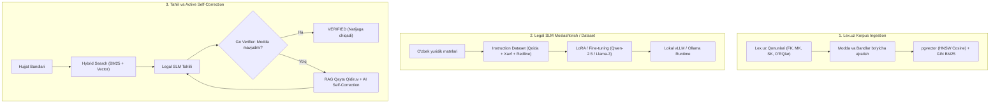

# 🏛️ LexGuard AI 3.0 — To'liq Bosh Arxitektura Spetsifikatsiyasi (Master Architecture Blueprint)

**Hujjat versiyasi**: 4.0.0 (Bosh Arxitektor va Loyiha Egasi tomonidan to'liq kelishilgan)  
**Sana**: 2026-11-21  
**Loyiha**: LexGuard AI (LexHackathon 2026, 1-trek: Huquqiy xizmatlar)  
**Holati**: `RATIFIED & APPROVED` (Barcha agentlar uchun qat'iy standart)

---

## 🎯 1. Loyiha Missiyasi va Maqsadi

LexGuard AI — **shtat yuristi bo'lmagan o'rta va kichik bizneslar (startuplar, YaTT, MChJ) hamda oddiy fuqarolar (B2C)** uchun shartnomalarni imzolashdan oldin qonuniy va tijoriy xatarlardan himoya qiluvchi intellektual yuridik xavfsizlik platformasi.

### Asosiy Tamoyillar:
1. **Ikki xil foydalanuvchi tajribasi**: B2B (Tadbirkorlik faoliyati) va B2C (Jismoniy shaxs / fuqaro) alohida moslashtirilgan interfeys va tahlil qoidalari.
2. **Onboarding**: Tushunarli Welcome/Landing sahifasi → Ro'yxatdan o'tish / Kirish → Bepul sinov kvotasi (Free trial).
3. **Maksimal Qamrov va Mustaqil AI**: Lex.uz qonunchilik bazasi asosida o'qitilgan/moslashtirilgan lokal Legal SLM (Small Language Model) + gibrid RAG.
4. **Anti-Hallucination & Active Self-Correction**: Noto'g'ri yoki uydirma moddalar 0%; agar AI keltirgan norma bazaga mos kelmasa, verifikator qidiruvni yangilab, AI ga qayta tahlil qildiruvchi intellektual sikl.
5. **Real-Time Streaming**: Hujjat tahlili uchun — Server-Sent Events (SSE); Ovozli yordamchi uchun — WebSockets (past kechikish).

---

## 🏗️ 2. Tizim Topologiyasi va Papkalar Tuzilishi

Loyiha quyidagi asosiy modullardan iborat bo'lib, har bir modulning ichki arxitekturasi Clean Architecture qoidalariga bo'ysunadi:

```
LexHackaton_DNK_CODE/
├── backend/          # Go 1.23+ Modular Monolith (Core Engine, Auth, Rules, SSE, WS, gRPC Client)
├── ai-engine/        # Python 3.11+ (FastAPI + gRPC Server, PyTorch, Lex.uz Ingestion, Legal SLM, OCR)
├── front/            # React 18+ TypeScript + Tailwind (Robin AI / Harvey LegalTech Studio, 3D, Voice)
├── mobile/           # Flutter 3.38+ (Soliq Glassmorphism, Dual Theme, Voice Radar, Biometric, FLAG_SECURE)
├── admin/            # React 18+ TypeScript (Platform Operator / System Overseer Dashboard)
├── deploy/           # Docker Compose, Nginx, Multi-stage Dockerfiles
├── orchestrator/     # 8 ta Agent Klasteri Boshqaruvi, Shartnomalar va Vazifalar Taxtasi
└── proto/            # Protobuf shartnomalari (Go va Python gRPC aloqasi uchun)
```

---

## ⚡ 3. Backend (Go) va AI Engine (Python) — gRPC Shartnomasi

Go backend yuqori yuklamali biznes mantiq, xavfsizlik va mijozlar ulanishini boshqaradi. AI bilan barcha hisob-kitoblar `proto/legal_ai.proto` orqali gRPC binar protokoli bilan uzatiladi.

```protobuf
syntax = "proto3";

package legal_ai.v1;
option go_package = "github.com/lexguard/backend/internal/gen/legal_ai/v1;legal_aiv1";

// Asosiy AI Servisi
service LegalAIService {
  // 1. Skan va rasmlarni OCR qilib, bandlarga ajratish
  rpc ProcessDocumentOCR (OCRRequest) returns (OCRResponse);

  // 2. Bandlarni Lex.uz RAG va Legal SLM orqali tahlil qilish
  rpc AnalyzeClauses (ClauseAnalysisRequest) returns (stream ClauseAnalysisEvent);

  // 3. Verifikatsiya muvaffaqiyatsiz bo'lganda AI qayta tahlil sikli (Self-Correction)
  rpc SelfCorrectFinding (SelfCorrectionRequest) returns (SelfCorrectionResponse);

  // 4. Jonli ovozli brifing va savol-javob (Live Voice)
  rpc GenerateVoiceBrief (VoiceBriefRequest) returns (VoiceBriefResponse);
  rpc StreamVoiceQuery (stream VoiceQueryChunk) returns (stream VoiceAnswerChunk);
}

message OCRRequest {
  string document_id = 1;
  bytes file_bytes = 2;
  string mime_type = 3;
}

message OCRResponse {
  string full_text = 1;
  repeated ExtractedClause clauses = 2;
  float confidence_score = 3;
}

message ExtractedClause {
  string clause_id = 1;
  string clause_number = 2;
  string text = 3;
  int32 page_number = 4;
}

message ClauseAnalysisRequest {
  string analysis_id = 1;
  string document_type = 2; // B2B_SERVICE, SUPPLY_SALE, COMMERCIAL_LEASE, EMPLOYMENT, etc.
  string contract_date = 3;
  string party_role = 4;     // EXECUTOR, CUSTOMER, NEUTRAL
  repeated ExtractedClause clauses = 5;
  bool use_local_slm_only = 6;
}

message ClauseAnalysisEvent {
  string event_type = 1; // "stage_changed", "partial_finding", "progress"
  int32 progress_pct = 2;
  string stage_name = 3;
  RawFinding finding = 4;
}

message RawFinding {
  string clause_id = 1;
  string risk_level = 2;    // RED, YELLOW, GREEN, GRAY
  string category = 3;      // LEGAL, COMMERCIAL, UNKNOWN
  string issue_title = 4;
  string issue_explanation = 5;
  string cited_article = 6; // e.g. "FK 707"
  string suggested_redline = 7;
  string balance_label = 8; // "Muvozanatli", "Ijrochiga og'ir", "Buyurtmachiga og'ir"
}

message SelfCorrectionRequest {
  string clause_text = 1;
  string previous_cited_article = 2;
  string verification_error = 3; // Nega xato bo'ldi
  repeated string candidate_articles = 4; // RAG topgan eng yaqin haqiqiy moddalar
}

message SelfCorrectionResponse {
  bool resolved = 1;
  RawFinding corrected_finding = 2;
}

message VoiceBriefRequest {
  string analysis_id = 1;
  string summary_text = 2;
  repeated RawFinding top_risks = 3;
}

message VoiceBriefResponse {
  string audio_script_uz = 1;
  string ssml = 2;
  int32 duration_sec = 3;
}

message VoiceQueryChunk {
  string session_id = 1;
  string user_query_text = 2;
  bytes audio_chunk = 3;
}

message VoiceAnswerChunk {
  string text_chunk = 1;
  bytes audio_chunk = 2;
  bool is_final = 3;
}
```

---

## 🧠 4. AI Engine & Lex.uz Korpusi — Gibrid RAG & SLM Arxitekturasi

`ai-engine/` quyidagi 3 ta asosiy bo'limdan tashkil topadi:



---

## 🎨 5. Web Frontend (React) — Robin AI Uslubidagi LegalTech Studiyasi

`front/` — Professional darajadagi huquqiy tahlil ish maydoni:
- **Welcome / Landing**: Qiymat taklifi, xavfsizlik afzalliklari, Kirish/Ro'yxatdan o'tish (B2B/B2C) va bepul sinov.
- **Contract Studio**:
  - **Chap Panel (Document Paper)**: To'liq shartnoma matni, 4 rangli inline xavf belgilari va Google Docs kabi sharhlar.
  - **O'ng Panel (Clause Inspector)**: Topilgan qonuniy xavf, aniq Lex.uz moddasi va havolasi, balans yorlig'i, **1 tugma bilan taklifni qabul qilish/rad etish (Accept/Reject Redline diff)**.
  - **Yuqori Panel**: Glanceable 0-100 radial speedometer, DNA barcode lentasi, 3D WebGL risk visualizer va Live Voice Assistant.
- **Eksport**: Izohli takliflar bilan DOCX, Kelishmovchiliklar bayonnomasi, "LOYIHA" to'liq tahrir DOCX va PDF.

---

## 📱 6. Mobile Client (Flutter) — Soliq-Style Premium Glassmorphism

`mobile/` — Tezkor va xavfsiz mobil tahlil markazi:
- **Dual-Theme**: B2C uchun Sapphire ko'k, B2B uchun Emerald yashil.
- **Soliq-style FAB**: Markazda katta Skaner/Yuklash tugmasi (Kamera yoki Fayl tanlash).
- **Draggable BottomSheet**: Shartnoma matnidagi xavf bosilganda pastdan ochiluvchi diff va tushuntirish oynasi.
- **Voice Radar & Biometriya**: Jonli animatsiyali audio to'lqinlar, FaceID/Fingerprint qulfi, `FLAG_SECURE` va Privacy Blur.

---

## 📊 7. Admin Portal (`admin/`) — Platforma Operatori Nazorat Markazi

Admin — bu **LexGuard AI servisining butun faoliyatini nazorat qiluvchi Bosh Operator Paneli**:
- **System Health**: Backend, AI Engine, PostgreSQL, Redis, MinIO monitoringi.
- **AI Telemetriya**: Tahlillar soni, gRPC tezligi, tokenlar sarfi.
- **Lex.uz Corpus Management**: Qonunlar bazasini to'ldirish va yangilash.
- **Human-in-the-Loop Review**: AI ishonchsiz deb topgan (`REVIEW_REQUIRED`) bandlarni nazorat qilish.
- **Users & Quotas**: Foydalanuvchilar va kvotalar nazorati.

---

## 🚦 8. Bajarilish Bosqichlari (Implementation Roadmap)

1. **Faza 1 (Poydevor)**: `proto/legal_ai.proto` + `ai-engine/` (gRPC + Lex.uz ingestion) + Docker Compose integratsiyasi.
2. **Faza 2 (Yadro va Mantiq)**: Go backend gRPC ulanishi + Active Self-Correction loop + SSE / WebSockets server.
3. **Faza 3 (Web Studio)**: Welcome Landing + Document Paper + Clause Inspector + Redline diff + 3D + Live Voice.
4. **Faza 4 (Mobile)**: Soliq Glassmorphism + FAB skaner + Draggable BottomSheet + Voice Radar + Biometriya.
5. **Faza 5 (Admin)**: Operator salomatligi, live trafik, AI telemetriyasi va Human-in-the-loop review.
6. **Faza 6 (Sinov va Ishga Tushirish)**: E2E testlar, Fuzzing, `./scripts/run_dev.sh` to'liq sinovi.
