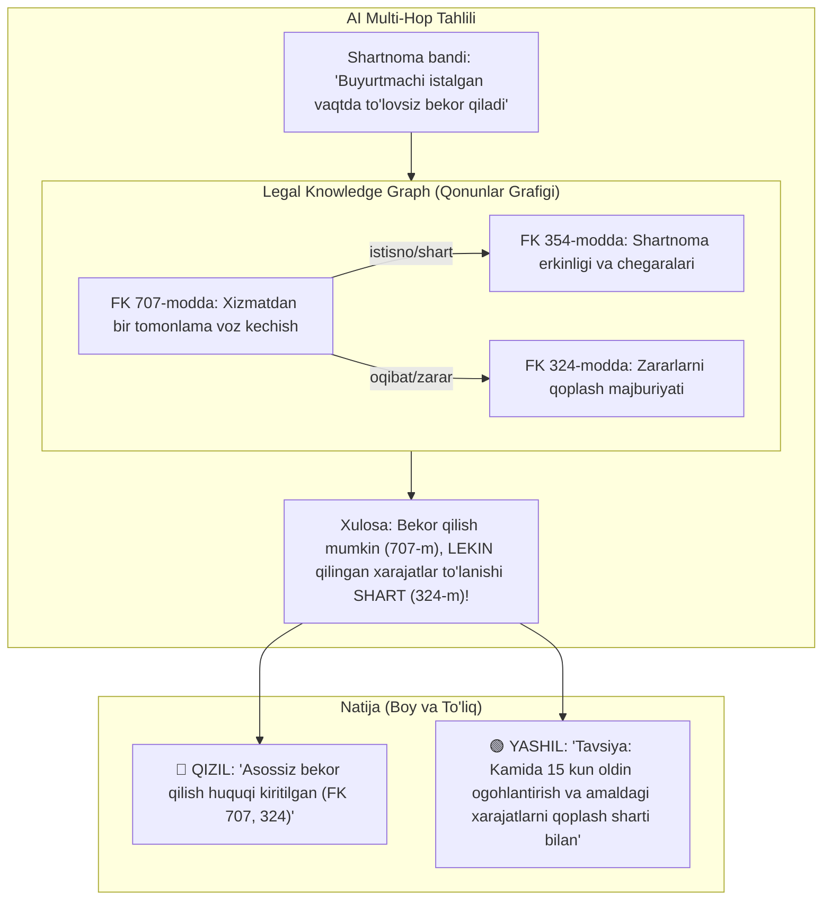

# 🏛️ LexGuard AI 3.0 — To'liq Bosh Arxitektura Spetsifikatsiyasi (Master Architecture Blueprint)

**Hujjat versiyasi**: 4.1.0 (Bosh Arxitektor va Loyiha Egasi tomonidan to'liq kelishilgan)  
**Sana**: 2026-11-21  
**Loyiha**: LexGuard AI (LexHackathon 2026, 1-trek: Huquqiy xizmatlar)  
**Holati**: `RATIFIED & APPROVED` (Barcha agentlar uchun qat'iy standart)

---

## 🎯 1. Loyiha Missiyasi va Maqsadi

LexGuard AI — **shtat yuristi bo'lmagan o'rta va kichik bizneslar (startuplar, YaTT, MChJ) hamda oddiy fuqarolar (B2C)** uchun shartnomalarni imzolashdan oldin qonuniy va tijoriy xatarlardan himoya qiluvchi intellektual yuridik xavfsizlik platformasi.

### Asosiy Tamoyillar:
1. **Ikki xil foydalanuvchi tajribasi**: B2B (Tadbirkorlik faoliyati) va B2C (Jismoniy shaxs / fuqaro) alohida moslashtirilgan interfeys va tahlil qoidalari.
2. **Onboarding**: Tushunarli Welcome/Landing sahifasi → Ro'yxatdan o'tish / Kirish (B2B/B2C tanlovi) → Bepul sinov kvotasi (Free trial).
3. **Minimalist System UI ("Kam so'z, aniq iconlar")**: Navbarda, sidebarda va boshqaruv tugmalarida faqat bitta so'zli yorliqlar (`Tahlil`, `Hujjatlar`, `Qonunlar`, `Profil`) va toza piktogrammalar.
4. **Boy va Aniq Yuridik Natija**: Tahlil natijasi qisqartirilmaydi. Xato/xavfli band **QIZIL**, uning tagida tavsiya etilgan to'g'ri tahrir **YASHIL** bo'lib yonma-yon/ostma-ost to'liq ko'rsatiladi.
5. **Legal Knowledge Graph (Bog'langan Qonunlar Grafigi)**: O'zbekiston qonunlaridagi murakkab o'zaro zanjirli havolalar (cross-references: A-modda → B-modda → C-modda) grafik orqali bog'lanadi. AI butun zanjirni o'qib, qonunning asl ma'nosini xatosiz chiqaradi.
6. **Ultra-Zamonaviy Web Dizayn**: **Liquid Glass** (suyuq shisha, frosted glass blur, oyna effekti) + **Three.js 3D WebGL** interaktiv sferik risk to'ri.
7. **Mobil Standart**: Soliq ilovasi uslubidagi Premium Glassmorphism (Sapphire B2C / Emerald B2B), suzuvchi Skaner FAB, Draggable BottomSheet diff, Voice Radar, Biometriya va `FLAG_SECURE`.
8. **Real-Time Streaming**: Hujjat tahlili uchun — SSE; Ovozli yordamchi uchun — WebSockets.

---

## 🏗️ 2. Tizim Topologiyasi va Papkalar Tuzilishi

```
LexHackaton_DNK_CODE/
├── backend/          # Go 1.23+ Modular Monolith (Core Engine, Auth, Rules, SSE, WS, gRPC Client)
├── ai-engine/        # Python 3.11+ (FastAPI + gRPC Server, PyTorch, Lex.uz Knowledge Graph, Legal SLM, OCR)
├── front/            # React 18+ TypeScript + Tailwind (Liquid Glass + Three.js 3D, Minimalist Chrome, Rich Diff)
├── mobile/           # Flutter 3.38+ (Soliq Glassmorphism, Dual Theme, Voice Radar, Biometric, FLAG_SECURE)
├── admin/            # React 18+ TypeScript (Platform Operator / System Overseer Dashboard)
├── deploy/           # Docker Compose, Nginx, Multi-stage Dockerfiles
├── orchestrator/     # 8 ta Agent Klasteri Boshqaruvi, Shartnomalar va Vazifalar Taxtasi
└── proto/            # Protobuf shartnomalari (Go va Python gRPC aloqasi uchun)
```

---

## ⚡ 3. Backend (Go) va AI Engine (Python) — gRPC Shartnomasi

Go backend va Python `ai-engine` o'rtasidagi aloqa `proto/legal_ai.proto` orqali gRPC binar protokoli bilan amalga oshiriladi:
- `ProcessDocumentOCR`: Skan qilingan PDF va rasmlarni OCR qilib, bandlarga ajratish.
- `AnalyzeClauses`: Bandlarni Lex.uz Knowledge Graph va Legal SLM orqali tahlil qilish (SSE stream bilan mijozga yetkaziladi).
- `SelfCorrectFinding`: Qonunlar zanjiri (Knowledge Graph) bo'yicha nomuvofiqlik bo'lsa, AI ga qayta tahlil qildiruvchi intellektual refleksiya.
- `GenerateVoiceBrief` & `StreamVoiceQuery`: WebSockets orqali jonli ovozli savol-javob.

---

## 🧠 4. Legal Knowledge Graph & Anti-Hallucination



---

## 🎨 5. Web UI/UX Standarti — "Liquid Glass + Three.js"

1. **Minimalist Boshqaruv (Chrome & Nav)**:
   - Navbarda va sidebarda faqat 1 ta so'z va aniq piktogramma:
     - `⚡ Tahlil` • `📂 Hujjatlar` • `⚖️ Qonunlar` • `👤 Profil`
   - Ortiqcha gaplar va uzun tushuntirishlar taqiqlanadi.
2. **Vizual Ko'rinish**:
   - **Liquid Glass**: `backdrop-filter: blur(20px)`, shaffof qoramtir oyna yuzasi (`rgba(15, 23, 42, 0.75)`), nozik neon chekkalar (`border: 1px solid rgba(255, 255, 255, 0.1)`).
   - **Three.js 3D WebGL**: Orqa fonda yoki tepada sekin aylanuvchi interaktiv sferik risk neyron to'ri.
3. **Hujjat Studiyasi**:
   - Chapda: To'liq shartnoma matni.
   - Har bir xavf aniqlangan band:
     - 🔴 **QIZIL**: Asl noqonuniy/nomutanosib band matni.
     - 🟢 **YASHIL**: Darhol uning tagida taklif etilayotgan to'g'ri yuridik tahrir (Redline).
   - O'ngda: Ixcham shisha inspektor (Lex.uz qonunlar zanjiri, havola, 1-tugmali `Qabul qilish / Rad etish`).
   - Jonli ovozli yordamchi: Sinusoidal to'lqinli kanvas (Live Waveform).

---

## 📱 6. Mobile Standarti (Flutter) — Soliq Premium Glassmorphism

1. **Dual-Theme**: B2C (Sapphire ko'k) va B2B (Emerald yashil).
2. **Markaziy FAB**: Katta suzuvchi Skaner tugmasi (Kamera / Fayl).
3. **Draggable BottomSheet**: Qizil/Yashil bandlar va havolalar pastdan silliq ochiladi.
4. **Xavfsizlik**: Biometrik qulf, Privacy Blur va `FLAG_SECURE`.

---

## 📊 7. Admin Platform Operator Portali

- **Health Monitor**: Go, Python AI, Postgres, Redis, MinIO holati.
- **AI Telemetriya**: gRPC latency, token sarfi, faol tahlillar.
- **Legal Knowledge Graph Boshqaruvi**: Bog'langan qonunlarni ko'rish va yangilash.
- **Human Review**: AI shubhalangan (`REVIEW_REQUIRED`) bandlarni tasdiqlash.

---

## 🚦 8. Yangi Bajarilish Bosqichlari (Roadmap)

1. **Faza 1 (Backend & AI Engine Poydevori)**: `proto/legal_ai.proto` + `ai-engine/` (FastAPI + gRPC + Legal Knowledge Graph) + Go gRPC client.
2. **Faza 2 (Web Studio — Liquid Glass + Three.js)**: Minimalist navbar/sidebar, 3D sferik vizualizator, Document Paper da Qizil/Yashil diff bloki.
3. **Faza 3 (Mobile Soliq UI)**: Soliq Glassmorphism, FAB skaner, Draggable BottomSheet diff.
4. **Faza 4 (Admin Platform Operator)**: Operator nazorat paneli.
5. **Faza 5 (E2E Test & Ishga Tushirish)**: `./scripts/run_dev.sh` to'liq 7-xizmatli stackni tekshirish.
