# 🛡️ LexGuard AI — O‘zbekiston Shartnomalarini AI Bilan Tekshirish Platformasi

[](./releases/LexGuard-AI.apk)
[](./ai-engine/AI_ARCHITECTURE.md)
[](./ai-engine/app/contract_dataset_builder.py)
[](./backend/api/openapi.yaml)
[](./mobile)

> **LexGuard AI** — O‘zbekiston Respublikasi qonunchiligi (**Lex.uz** rasmiy bazasi) asosida shartnomalarni soniyalar ichida tahlil qiladigan, qonunga zid bandlarni **aniq modda havolasi va tahrir taklifi (Redline)** bilan ko‘rsatadigan, taxmin qilmaydigan (**Zero-Hallucination / Fail-Closed**) huquqiy-tahliliy platforma.

---

## 📱 Android Ilovani Yuklab Olish (Tayyor Release APK)

Ilovani darhol Android telefoningizga o‘rnatib ko‘rish uchun:

👉 **[📥 LexGuard-AI.apk ni yuklab olish](./releases/LexGuard-AI.apk)** *(Android Release APK · `arm64-v8a` · **43.7 MB** — `releases/LexGuard-AI.apk`)*

> **O‘rnatish tartibi:**
> 1. Yuqoridagi havoladan `LexGuard-AI.apk` faylini telefoningizga yuklab oling (GitHub’da ochilsa **View raw / Download** tugmasini bosing).
> 2. Telefoningizda *«Noma’lum manbalardan o‘rnatish»* (Install unknown apps) ruxsatini yoqing.
> 3. Ilovani ochib **Fuqaro (B2C)** yoki **Yuridik shaxs (B2B)** rejimida shartnomani skanerlang, yuklang va sinab ko‘ring!

---

## 🎯 Loyiha Nima Qiladi? (Asosiy Imkoniyatlar)

### 🚦 3 Rangli «Svetofor» Tizimi + Rangsiz «Tekshirilmadi»
LexGuard AI foydalanuvchini chalkash foizlar (`X / 100`) bilan emas, **tushunarli 3 rang + halol «0» xulosa** bilan ogohlantiradi:

| Holat | Ma’nosi | Tizim harakati |
|---|---|---|
| 🔴 **Qizil** | **Qonunga zid** | Faqat Lex.uz 2,058 modda bazasida **tasdiqlangan** imperativ norma buzilganda chiqadi (aniq modda + havola + tayyor Redline). |
| 🟡 **Sariq** | **Qonunga mos, lekin e’tibor kerak** | Tijoriy nomutanosiblik yoki tartibiy xavf (*«qilmasangiz → oqibat»* formatida: masalan, cheklanmagan penya, mediatsiya yo‘qligi, E-ijara eslatmasi). |
| 🟢 **Yashil** | **Muammo topilmadi** | Band O‘zbekiston qonunchiligiga va taraflar muvozanatiga mos. |
| ⚪ **Tekshirilmadi («0»)** | **Qamrovdan tashqarida** | Xorijiy qonun (`English law`, `LCIA`, `ICC`, `ГК РФ`) yoki bazada manba topilmagan band — **tizim hech qachon taxmin qilmaydi** va **hamkor advokat**ga yo‘naltiradi. |

### 👤 Ikki Segment: Fuqaro (B2C) va Yuridik Shaxs (B2B)
- **Fuqaro (Jismoniy shaxs):**
  - Shartnomani kamera (OCR) yoki PDF/DOCX/Rasm orqali yuklash va bandma-band tahlil.
  - **O‘zbek tilining 3 yozuvida** ishlash: Isloh qilingan lotin (`Ş Ç Ğ Ö`), Eski lotin (`sh ch g' o'`) va Kirill (`ў қ ғ ҳ`).
  - Tariflar: **Bepul (`3` tekshiruv/oy)** va **Bir martalik to‘liq paket (`19,900 so‘m`)**.
- **Yuridik shaxs (Tadbirkor / MChJ — B2B):**
  - **Profil → Firma hujjatlari:** korxonaning ichki shartnomalari va nizomlarini yuklab, doimiy nazoratga qo‘yish.
  - **Jonli Qonun Monitoringi & Bildirishnomalar:** Lex.uz’da qonun o‘zgarganda aynan qaysi firma hujjatining qaysi bandi eskirganini **Git uslubidagi Oldin/Keyin (Before/After Diff)** ko‘rinishida ko‘rsatish.
  - **3 xil eksport:** Izohli takliflar (`.docx`), To‘liq tahrirlangan loyiha (`.docx` — *«LOYIHA — TARAFLAR KELISHMAGUNCHA IMZOLANMAYDI»* muhri bilan) va Hamkorga neytral xat.
  - Tariflar: **14 kunlik sinov (`10` hujjat)**, **Biznes (`199,000 so‘m` / `30` hujjat)**, **Pro (`399,000 so‘m` / `80` hujjat)**, qo‘shimcha hujjat (`9,900 so‘m`).

---

## 🏗️ Umumiy Tizim Arxitekturasi

```mermaid
flowchart LR
    subgraph Clients["Foydalanuvchi Ilovalari"]
        M["📱 Flutter Mobile App<br/>(Android / iOS)"]
        W["🌐 Web App (React/Shadcn)"]
        AD["🛠️ Admin Panel"]
    end

    subgraph GoBackend["Go Modular Monolith Backend (:8080)"]
        API["REST API + Swagger (/docs)"]
        PII["🔒 PII Masking (O'RQ-547)<br/>Pasport / JShShIR / +998"]
        GATE["🛡️ External LLM Gate<br/>(RESTRICTED & Consent)"]
        WORK["⚙️ Async WorkerPool +<br/>DOCX / Letter Exporter"]
        MON["📡 B2B Vault & Law Monitoring"]
    end

    subgraph AIEngine["Python AI Engine (:8000 REST + :50051 gRPC)"]
        NORM["1. Uzbek Normalizer<br/>(Kirill / Isloh / Eski lotin)"]
        NOTARY["2. 3-Layer Notarial<br/>vs Oddiy Classifier"]
        KG["3. Lex.uz Knowledge Graph<br/>2,058 modda · 2,086 bog'lanish"]
        NN["4. Local PyTorch Neural Net<br/>LexGuard-LocalNet-v1 (model.pt)"]
        BM25["5. BM25 Lexical RAG<br/>13,794 yuridik termin"]
        VER["6. Closed-World Verifier<br/>(Zero Hallucination / Fail-Closed)"]
    end

    M & W & AD --> API
    API --> PII --> GATE --> WORK
    API --> MON
    WORK --> NORM --> NOTARY --> KG --> NN --> BM25 --> VER
```



---

## 🧠 AI Engine: RAG, Fine-Tuning va Notarial Arxitektura

Batafsil texnik hujjat: **[ai-engine/AI_ARCHITECTURE.md](./ai-engine/AI_ARCHITECTURE.md)**

### 1. 3-Qavatli Notarial vs Oddiy Shartnoma Aniqlash ([notarial_classifier.py](./ai-engine/app/notarial_classifier.py))
1. **1-qavat (Qonun talabi):** Bitim turi O‘zbekiston qonunchiligiga ko‘ra majburiy notarialmi (`FK 110, 112, 271, 138`: ko‘chmas mulk/avtomobil oldi-sotdi va hadya, ipoteka, nikoh, vasiyatnoma, qayta ishonish), **E-ijara** talab qiladimi (`FK 574`: ofis/turar joy ijarasi — **notarius shart emas**, lekin `ijara.soliq.uz` hisobiga qo‘yish zarur), yoki **Oddiy yozma** yetarlimi (`B2B xizmat, pudrat, yetkazib berish, mehnat, qarz, NDA`).
2. **2-qavat (Notarial rekvizitlar ball tizimi):** Inkor iboralar (`notariussiz`, `notarial tasdiqlashsiz`) tekshiriladi; aks holda notarius ustxati (`+3`), `e-notarius.uz` / reyestr raqami (`+3`), gerbli blanka/davlat boji (`+2`), QR-kod (`+2`) ballanadi (`>= 3` → tasdiqlangan notarial hujjat).
3. **3-qavat (Butun hujjat konteksti):** 1-bandda «Kvartira oldi-sotdi» bo‘lib, oxirgi sahifada notarius muhri va reyestr raqami bo‘lsa, tizim noto‘g‘ri Qizil xato bermaydi (`VERIFIED_NOTARIAL_DOCUMENT`).

### 2. RAG Korpusi (Lex.uz Ground Truth)
- **10 ta asosiy qonun** (`FK-UZ-1`, `FK-UZ-2`, `MK-2022`, `670-I`, `221-I`, `ORQ-482`, `ORQ-547`, `ORQ-684`, `ORQ-792`, `ORQ-850`) — **2,058 ta modda** ([uzbek_legal_corpus_unified.json](./ai-engine/data/uzbek_legal_corpus_unified.json)).
- **Multi-Hop Knowledge Graph:** **2,086 ta** moddalararo bog‘lanish (`FK 707 → FK 354, FK 324`; `FK 326 → 670-I 25-modda`).
- **BM25 Vector Store:** **13,794 ta** leksik termin (Kirill va Lotin yozuvlarida bir xil qidiradi).

### 3. 2-Darajali Fine-Tuning + 600 Shartnoma Benchmarki
- **Dataset ([contract_dataset_builder.py](./ai-engine/app/contract_dataset_builder.py)):**
  - **600 ta to‘liq shartnoma** (240 Yashil + 300 Qizil/Sariq + 60 Xorijiy Fail-Closed) va **124 ta noyob xato senariysi** (15 ta yuridik oila, 3 yozuvda).
  - **1,524 train / 590 held-out eval** (`0` ta contract_id kesishuvi — nol data leakage), RAFT `<legal_context>` + qat’iy JSON + adversarial prompt-injection himoyasi bilan.
- **Local PyTorch Fine-Tuning ([train_local_model.py](./ai-engine/app/train_local_model.py) → [model.pt](./ai-engine/models/lexguard-local-net/model.pt)):**
  - CPU’da `16.97` soniyada o‘qitilgan **3-boshli PyTorch Multi-Task Residual Network (`1,188,377` parametr, `4.66 MB`)**: Risk (4 sinf) + Closed-World Lex.uz modda + Notarial shakl. Inference `< 2 ms`, faqat `confidence >= 0.78` va allowlist tasdiqi bilan chiqadi.
- **Bulutli GPU SLM QLoRA ([train_slm.py](./ai-engine/app/train_slm.py) + [slm_runtime.py](./ai-engine/app/slm_runtime.py)):**
  - `Qwen/Qwen2.5-1.5B-Instruct` uchun 4-bit NF4 QLoRA (7 linear qatlam), **Assistant-Only Loss Masking (`-100`)**, **Pre-Training Quality Gate**, `NEFTune` va `EarlyStopping`.

### 📊 Regressiya Benchmark Natijalari (600 ta sintetik shartnoma)

| Ko‘rsatkich | Natija |
|---|---|
| Notarial vs Oddiy aniqligi | **600 / 600 (100.0%)** |
| Xato bandlarni topish — Recall (124 senariy) | **400 / 400 (100.0%)** |
| To‘g‘ri (Yashil) shartnomalarda False Positive | **0.0% (240 / 240 toza)** |
| Xorijiy qonun Fail-Closed (`UNKNOWN`) | **60 / 60 (100.0%)** |
| Lex.uz Allowlist tasdiqi (Nol hallucination) | **400 / 400 (100.0%)** |
| Local PyTorch Held-out Eval (590 unseen namuna) | **Risk 100.0% · Article 100.0% · Form 100.0%** |

> *Eslatma: Ushbu ko‘rsatkichlar 600 ta sintetik regressiya benchmarki natijasidir. Real hayotdagi noodatiy yoki ikki xil talqinli shartnomalarda tizim ishonchi `< 0.78` bo‘lsa tavakkal qilmasdan `Tekshirilmadi («0»)` chiqaradi va hamkor advokatga yo‘naltiradi.*

---

## 🚀 Qanday Ishga Tushiriladi? (Quick Start)

### 1-usul: Docker Compose orqali butun tizimni bir buyruqda ko‘tarish
```bash
cp .env.example .env
docker compose up --build
```
Ishga tushgach:
- **Backend Swagger UI:** `http://localhost:8080/docs`
- **AI Engine Swagger UI:** `http://localhost:8000/docs`
- **AI Engine Health:** `http://localhost:8000/health`

### 2-usul: Har bir servisni alohida (Local Development)

#### 🧠 AI Engine (Python 3.10+)
```bash
# 1. Zero-dependency HTTP server (hech qanday qo'shimcha kutubxonasiz ham ishlaydi!)
python ai-engine/app/server.py

# 2. Yoki FastAPI + gRPC to'liq rejim
pip install -r ai-engine/requirements.txt
python ai-engine/app/main.py
```

#### ⚙️ Backend (Go 1.23+)
```bash
cd backend
go test ./...
go run ./cmd/server
```

#### 📱 Mobile Ilova (Flutter 3.24+)
```bash
cd mobile
flutter pub get
flutter run --dart-define=USE_MOCK=false --dart-define=API_BASE_URL=http://10.0.2.2:8080
```
*(Demo/offline rejim uchun oddiy `flutter run` — `USE_MOCK=true` standart yoqilgan.)*

#### 🧪 Testlar, 600-Shartnoma Benchmark va Local Fine-Tuning
```bash
# 600 shartnoma & 124 xato turi benchmarkini jonli yurgizish
python ai-engine/app/contract_dataset_builder.py --no-write

# Local PyTorch modelini qayta o'qitish (~17 soniya, CPU)
python ai-engine/app/train_local_model.py

# GPU QLoRA SLM Quality Gate (yoki GPU'da real trening)
python ai-engine/app/train_slm.py --dry-run
# GPU: python ai-engine/app/train_slm.py --model Qwen/Qwen2.5-1.5B-Instruct --qlora --epochs 3

# Barcha AI Engine testlari (11 ta test)
python ai-engine/test_ai_engine.py
```

---

## 🔌 Asosiy API Endpointlar

| Servis | Method & Path | Vazifasi |
|---|---|---|
| **Backend** | `POST /api/v1/auth/register`, `/login` | B2C (`individual`) / B2B (`business` + `inn`) ro‘yxatdan o‘tish |
| **Backend** | `GET /api/v1/billing/plans?segment=individual\|business` | Rasmiy B2C / B2B tariflar katalogi |
| **Backend** | `POST /api/v1/documents` | PDF, DOCX, JPG, PNG yuklash (rasmlar AI Engine OCR’ga uzatiladi) |
| **Backend** | `POST /api/v1/analyses`, `GET /api/v1/analyses/{id}` | Shartnomani asinxron tahlil qilish va natijani olish |
| **Backend** | `GET /api/v1/analyses/{id}/report?format=...` | `docx_comments`, `docx_draft`, `letter`, `md` eksporti |
| **Backend** | `GET/POST /api/v1/company-documents` | B2B firma hujjatlari ombori |
| **Backend** | `GET /api/v1/law-monitoring/alerts` | Lex.uz qonun o‘zgarishlari monitoringi (Before/After diff) |
| **AI Engine** | `POST /api/v1/analyze-clauses` | Bandlar tahlili + `document_form` + `multi_hop_chain` |
| **AI Engine** | `POST /api/v1/classify-form` | 3-qavatli Notarial vs Oddiy shartnoma klassifikatsiyasi |
| **AI Engine** | `GET /api/v1/verify-citation?article=...` | Closed-World Lex.uz allowlist verifikatori |
| **AI Engine** | `POST /api/v1/self-correct` | Fail-closed Active Self-Correction |
| **AI Engine** | `POST /api/v1/ocr` | PDF / DOCX / rasm (magic-byte) OCR va bandlarga ajratish |

To‘liq OpenAPI spetsifikatsiyasi: **[backend/api/openapi.yaml](./backend/api/openapi.yaml)** va **[BACKEND_API_DOCS.md](./BACKEND_API_DOCS.md)**.

---

## 📂 Loyiha Tuzilmasi

```text
LexHackaton_DNK_CODE/
├── releases/
│   └── LexGuard-AI.apk               # 📱 Tayyor Android Release APK (yuklab olish uchun)
├── mobile/                           # 📱 Flutter (Android / iOS) — 3 rangli Svetofor, OCR, B2B Monitoring
├── backend/                          # ⚙️ Go Modular Monolith — PII Masking, LLM Gate, DOCX Export, Billing
│   ├── api/openapi.yaml              # OpenAPI 3.0.3 hujjati
│   └── internal/                     # ai, analysis, api, billing, documents, identity, privacy, report, rules
├── ai-engine/                        # 🧠 Python AI Engine (FastAPI + gRPC + Zero-Dep HTTP)
│   ├── AI_ARCHITECTURE.md            # AI, RAG va Fine-Tuning texnik hujjati
│   ├── app/                          # knowledge_graph, notarial_classifier, normalizer, local_model_runtime, train_local_model, train_slm, ocr
│   ├── data/                         # Lex.uz 2,058 modda + 600 shartnoma benchmark + SFT train/eval JSONL
│   └── models/lexguard-local-net/    # Local o'qitilgan PyTorch model.pt (4.66 MB) + eval_report.json
├── front/                            # 🌐 Web frontend (React + Shadcn UI)
├── admin/                            # 🛠️ Admin panel
├── deploy/                           # 🐳 Dockerfiles & docker-compose.yml
├── proto/                            # ⚡ gRPC shartnomasi (legal_ai.proto)
└── presentation/                     # 📊 Loyiha hujjati (LexGuard-AI-Loyiha.docx) va Pitch Deck (.pptx)
```

---

## ⚖️ Huquqiy Eslatma
**LexGuard AI** yuridik maslahat bermaydi — u O‘zbekiston Respublikasi rasmiy qonunchiligi (Lex.uz) asosida shartnomalarni dastlabki tahlil qiluvchi **axborot-tahliliy vosita**dir. Qamrovdan tashqari yoki noaniq masalalarda (`Tekshirilmadi / «0»`) yakuniy qaror uchun litsenziyaga ega advokatga murojaat qilish tavsiya etiladi.
