# 🛡️ LexGuard AI — Bosh Arxitektor Holat Hisoboti

**Sana**: 2026-11-21 10:42 (Toshkent)  
**Sprint**: MVP Sprint 1  
**Klaster**: 8 Profil Avtonom Swarm  

---

## 📊 Umumiy Holat: Sprint **~90% Done**

```mermaid
flowchart LR
    subgraph DONE["✅ DONE (38 / 42 vazifa)"]
        T101["TASK-101..108<br/>Backend Go"]
        T201["TASK-201..206<br/>Mobile Flutter"]
        T301["TASK-301..307<br/>Web Frontend"]
        T401["TASK-401..402<br/>Admin Portal"]
        T501["TASK-501..503<br/>Legal RAG AI"]
        T601["TASK-601..603<br/>QA Security"]
        T701["TASK-701..703<br/>DevOps"]
        T001["TASK-001..005<br/>Orchestrator"]
    end

    subgraph WIP["🟡 IN PROGRESS (4 vazifa)"]
        T006["TASK-006 — Yakuniy Integratsion Audit"]
        T207["TASK-207 — Offline Kesh"]
        T403["TASK-403 — Kvota/Audit Trail"]
        T504["TASK-504 — Temporal Qidiruv"]
        T604["TASK-604 — Stress/Pentest"]
    end

    DONE --> WIP
```

---

## 🛰️ Agent-bo'yicha Batafsil Holat

| Agent | Profil | DONE | WIP | Bloker |
|:--|:--:|:--:|:--:|:--:|
| 👑 **0-ORCHESTRATOR** | agy1 | 5/6 | TASK-006 | Qolgan vazifalar yakunlanishi kutilmoqda |
| ⚙️ **1-BACKEND-GO** | agy2 | **8/8** ✅ | — | — |
| 📱 **2-MOBILE-FLUTTER** | agy3 | 6/7 | TASK-207 | — |
| 🌐 **3-WEB-FRONT** | agy4 | **7/7** ✅ | — | — |
| 📊 **4-ADMIN-PORTAL** | agy5 | 2/3 | TASK-403 | — |
| ⚖️ **5-LEGAL-RAG-AI** | agy6 | 3/4 | TASK-504 | — |
| 🛡️ **6-QA-SECURITY** | agy7 | 3/4 | TASK-604 | — |
| 🚀 **7-DEVOPS-INFRA** | agy8 | **3/3** ✅ | — | — |

---

## 🏗️ Kod Inventarizatsiyasi

### Backend (Go) — 12 Bounded Context ✅
| Modul | Fayl | Testlar |
|:--|:--|:--:|
| `cmd/server` | `main.go` (DI wiring, 12 modul, graceful shutdown) | — |
| `cmd/migrate` | `main.go` (migratsiya CLI) | — |
| `internal/platform` | `config.go`, `db.go`, `jwt.go`, `middleware.go`, `response.go` | — |
| `internal/identity` | `service.go` (Auth, JWT, RBAC, Tenant) | — |
| `internal/documents` | `parser.go`, `repository.go` | `fuzz_test.go` |
| `internal/privacy` | `pii.go`, `gate.go` (PII maskalash + LLM gate) | `pii_test.go` |
| `internal/legalcorpus` | `repository.go`, `corpus_data.go` (FK 364/707/326) | `repository_test.go` |
| `internal/rules` | `rules.go` (10 ta deterministik qoida) | `rules_test.go` |
| `internal/ai` | `provider.go`, `prompts.go` (Pluggable LLM) | `provider_test.go` |
| `internal/verification` | `arbiter.go` (5-holatli verifier) | `arbiter_test.go` |
| `internal/analysis` | `service.go`, `worker.go` (Pipeline + SSE + Worker Pool) | — |
| `internal/report` | `report.go` (DOCX/PDF eksport) | — |
| `internal/signing` | `signing.go` (E-IMZO mock) | — |
| `internal/billing` | `billing.go` (Kvota atomik bron) | — |
| `internal/audit` | `audit.go` (Append-only log) | — |
| `internal/admin` | `service.go` (Admin xizmatlari) | — |

### Frontend (React) — 25 fayl ✅
Asosiy komponentlar: `ContractStudio`, `SideBySideDiffViewer`, `ContractHealthGauge`, `Contract3DVisualizer`, `Mini3DVisualizer`, `LiveVoiceAssistant`, `AuthModal`, `ContractUploader`

### Mobile (Flutter) — 29 Dart fayl ✅
Feature-First Clean Architecture: `auth`, `home`, `scanner_upload`, `documents`, `analysis`, `contracts`, `legal_corpus`, `profile`, `session` + Core: `security`, `theme`, `network`, `widgets`

### DevOps/Infra ✅
- `docker-compose.yml` — 6 xizmat (Postgres+pgvector, Redis, MinIO, Backend, Frontend, Admin)
- 4 ta Dockerfile (backend distroless, frontend nginx, admin)
- `run_dev.sh` — 7 rejimli idempotent skript
- `ci.yml` — 7 jobli CI pipeline

---

## 🟡 Qolgan 4+1 IN_PROGRESS Vazifalar va Harakat Rejasi

### 1. `TASK-207` — Flutter Shifrlangan Offline Kesh
- **Agent**: 📱 2-MOBILE-FLUTTER (agy3)
- **Holat**: `local_demo_lexguard_repository.dart` mavjud, Drift+SQLCipher integratsiyasi to'liq emas
- **Kerakli ish**: SQLCipher kalit boshqaruvi, stale-while-revalidate logikasi
- **Bloker**: Yo'q
- **Ustuvorlik**: P1 (Demo uchun critical emas, lekin MASVS-L2 uchun kerak)

### 2. `TASK-403` — Admin Kvotalar/Audit Trail
- **Agent**: 📊 4-ADMIN-PORTAL (agy5)
- **Holat**: Admin faqat placeholder `index.html` — haqiqiy React/HTML portal hali qurilmagan
- **Kerakli ish**: Kvota paneli, xodimlar audit jurnali, tarif ko'rsatkichlari
- **Bloker**: Backend API tayyor (billing, audit endpointlar mavjud)
- **Ustuvorlik**: P1

### 3. `TASK-504` — Temporal Qidiruv Qoidasi
- **Agent**: ⚖️ 5-LEGAL-RAG-AI (agy6)  
- **Holat**: `corpus_data.go` da FK moddalari bor, lekin FK 4-modda bo'yicha `effective_from <= contract_date` SQL filtri to'liq sinalmagan
- **Kerakli ish**: Temporal pre-filter testlari, eskirgan tahrir qaytmasligi kafolati
- **Bloker**: Yo'q
- **Ustuvorlik**: P1

### 4. `TASK-604` — Stress va Pentest
- **Agent**: 🛡️ 6-QA-SECURITY (agy7)
- **Holat**: Magic-byte, MASVS-L2 va WebGL auditlar bajarilgan; fuzzing va yuklanish testlari hali yo'q
- **Kerakli ish**: `go test -fuzz`, API rate-limit testlari, 100 concurrent upload simulyatsiyasi
- **Bloker**: Yo'q
- **Ustuvorlik**: P1

### 5. `TASK-006` — Yakuniy Integratsion Audit (Orchestrator)
- **Holat**: Yuqoridagi 4 vazifa yakunlangach, to'liq end-to-end audit o'tkaziladi
- **Bloker**: TASK-207, 403, 504, 604 ga bog'liq
- **Ustuvorlik**: P0 — bu MVP yakuniy qabul qilish darvozasi

---

## 🔗 API Shartnomasi Muvofiqlik Tekshiruvi

| Endpoint | CONTRACTS.md | OpenAPI | Backend Code | Frontend | Mobile |
|:--|:--:|:--:|:--:|:--:|:--:|
| `GET /healthz` | ✅ | ✅ | ✅ | — | — |
| `POST /auth/demo-session` | ✅ | ✅ | ✅ | ✅ | ✅ |
| `POST /auth/consents` | ✅ | ⚠️ yo'q | ✅ | — | — |
| `POST /documents` | ✅ | ✅ `/contracts` | ✅ | ✅ | ✅ |
| `POST /analyses` | ✅ | ✅ | ✅ | ✅ | ✅ |
| `GET /analyses/{id}/events` (SSE) | ✅ | ✅ | ✅ | ✅ | ✅ |
| `GET /analyses/{id}` | ✅ | ✅ | ✅ | ✅ | ✅ |
| `GET /analyses/{id}/report` | ✅ | ✅ | ✅ | ✅ | — |
| `GET /analyses/{id}/voice-brief` | ✅ | ✅ | ✅ | ✅ | ✅ |
| `POST /analyses/{id}/voice-query` | ✅ | ✅ | ✅ | ✅ | ✅ |
| `GET /integrations/status` | ✅ | ✅ | ✅ | — | ✅ |

> [!WARNING]
> **OpenAPI yo'l nomlari**: `CONTRACTS.md` da `/documents` ishlatilgan, `openapi.yaml` da esa `/contracts`. Yagona standartga keltirilishi kerak (CONTRACTS.md ustuvor).

---

## 🎯 Keyingi Qadamlar (Buyruq)

| # | Harakat | Agent | Muddati |
|:--:|:--|:--:|:--:|
| 1 | TASK-504: Temporal SQL pre-filter test to'plami yozish | agy6 | Bugun |
| 2 | TASK-403: Admin Portal haqiqiy UI qurish (Kvota + Audit) | agy5 | Bugun |
| 3 | TASK-207: SQLCipher kalit + stale-while-revalidate | agy3 | Bugun |
| 4 | TASK-604: Fuzz test + Rate-limit stress test | agy7 | Bugun |
| 5 | OpenAPI endpoint nomlarini CONTRACTS.md ga moslashtirish | agy2 | Bugun |
| 6 | TASK-006: Yakuniy end-to-end integratsion audit | agy1 | #1-5 tugagach |

---

## 📌 Definition of Done Checklist (MVP)

- [x] 1. Arxitektura D-01..D-10 invariantlari — 100% mos
- [x] 2. API Shartnomasi (CONTRACTS.md) — Backend, Frontend, Mobile mos
- [x] 3. 10-Vektorli Anti-Gallyutsinatsiya — Verifier, Arbiter, Go Rules
- [x] 4. PII Maskalash (O'RQ-547) — Backend + Mobile + Frontend
- [ ] 5. Testlar — Backend unit ✅, Mobile widget ✅, **Fuzz/Stress hali**
- [ ] 6. `./scripts/run_dev.sh` — Skript tayyor ✅, **end-to-end sinov kerak**

